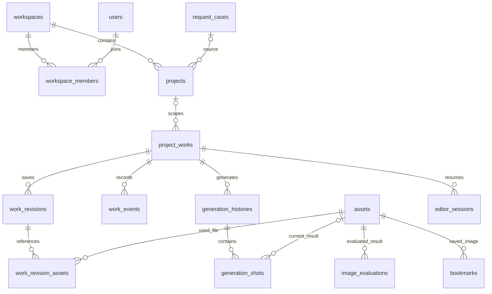

# ITDA Studio 데이터베이스 구조

기준일: 2026-11-25. 이 문서는 저장소의 migration과 현재 앱 코드를 기준으로 작성했다. 운영 DB의 실시간 행 수나 별도로 수정한 스키마를 조회한 결과는 아니다.

## 기준 파일

| 파일 | 역할 |
| --- | --- |
| [초기 스키마](../supabase/migrations/20261125000000_initial_studio.sql) | 테이블 25개, FK, CHECK, 인덱스, 검증 트리거, RLS |
| [클라우드 저장](../supabase/migrations/20261125010000_cloud_persistence.sql) | 앱 저장용 RPC, 컷 논리 삭제, 브랜드 잠금 버전, 북마크 스냅샷, 사용량의 선택적 실행 연결 |
| [BF 임베딩](../supabase/migrations/20261125020000_brand_appearance_embeddings.sql) | 이전 BF 구조(다음 migration에서 대체), Pool revision, 출처, 서버 RPC |
| [현재 브랜드 집계](../supabase/migrations/20261125030000_current_brand_embeddings.sql) | 이전 BF 5개 테이블 제거, 브랜드 현재 집계 1개, 이미지별 최신 4항목 평가 |
| [브랜드 임베딩 저장 설계](brand-embedding-storage.md) | 설계 근거, 무결성, Python 작업자 연결 계약과 구현 범위 |
| [연결·실행 안내](../supabase/README.md) | 환경변수, migration 적용, 앱 저장 경로 |
| [서버 데이터 계층](../system/server/cloud-studio.ts) | DB 행과 앱 데이터 변환, 조회·저장 |
| [파일 저장 계층](../system/server/cloud-assets.ts) | 자산 등록과 R2 파일 처리 |

스키마 변경 시 migration을 먼저 추가하고 이 문서도 함께 갱신한다. 아래 컬럼 목록은 네 migration을 순서대로 적용한 최종 정의다.

## 저장소와 접근 범위

| 위치 | 저장 내용 |
| --- | --- |
| Supabase `public` | 업무 테이블 26개와 서버용 저장·Pool RPC |
| Supabase `auth.users` | Supabase Auth가 관리하는 사용자. 앱의 26개 테이블 수에는 포함하지 않는다. |
| Supabase `studio_private` | 검증·프로필 생성·접근 제어용 함수. 업무 테이블은 없다. |
| Cloudflare R2 | 이미지와 의뢰서 파일의 실제 바이트 |
| 브라우저 | 테마·목업 모드·열린 프로젝트 탭 ID 등 개인 설정. 업무 데이터의 영구 저장소로 사용하지 않는다. |

현재 앱은 공용 비밀번호 로그인이다. 서버가 `STUDIO_WORKSPACE_ID`, `STUDIO_OWNER_USER_ID`를 통해 하나의 워크스페이스와 소유자를 결정한다. 브라우저가 요청 본문으로 이 범위를 지정할 수 없다. 개별 사용자 로그인으로 전환할 때는 이 범위 결정 로직을 인증 사용자와 멤버십에 연결해야 한다.

## 주요 관계

아래 그림은 핵심 관계를 발췌한 것이다. 모든 연결 테이블과 복합 FK는 뒤의 목록과 migration을 참조한다.



### 구분해야 하는 세 종류의 기록

| 개념 | 테이블 | 의미 |
| --- | --- | --- |
| 작업 내역 | `project_works`, `work_events` | 프로젝트에서 어떤 작업을 진행했는지 |
| 작업 복원 상태 | `work_revisions`, `editor_sessions` | 어떤 입력·편집 내용·단계로 작업을 재개할지 |
| 하단 히스토리 | `generation_histories`, `generation_shots` | 하단 패널에서 선택하는 생성 이미지 묶음과 컷 |

프로젝트가 없는 작업도 `project_works`를 가진다. `project_works.project_id`, `generation_histories.project_id`의 NULL은 **프로젝트 없는 작업**을 의미한다. 전체 프로젝트를 뜻하지 않는다. 한 히스토리는 반드시 작업에 연결되며, 프로젝트 소속은 연결한 작업과 NULL까지 동일해야 한다.

## 테이블 목록

| 영역 | 테이블 | 역할·주요 관계 |
| --- | --- | --- |
| 사용자 | `users` | `auth.users`와 같은 ID를 사용하는 앱 프로필 |
| 사용자 | `workspaces` | 데이터 소유 범위인 조직·팀 |
| 사용자 | `workspace_members` | 사용자 소속과 `owner/admin/member/viewer` 권한 |
| 파일 | `assets` | R2 bucket/object key, 파일 메타데이터, 업로드 상태 |
| 의뢰 | `request_cases` | 요청 내용, 고객 정보, 외부 시스템 ID |
| 의뢰 | `request_case_assets` | 의뢰와 첨부 파일의 연결·용도·순서 |
| 프로젝트 | `projects` | 프로젝트 기본 정보, 의뢰 연결, 담당자, 납기, 진행 단계 |
| 작업 | `project_works` | 컷 생성·상세 페이지의 개별 작업. 프로젝트 연결은 선택 사항 |
| 작업 | `work_revisions` | 작업 상태 JSON, 문서 형식 버전, 초안 여부, 잠금 버전 |
| 작업 | `work_revision_assets` | 작업 버전이 사용하는 파일의 명시적 참조 |
| 작업 | `work_events` | 작업 이벤트와 관련 payload |
| 복원 | `editor_sessions` | 사용자·프로젝트·작업 종류별 재개 위치 |
| 생성 | `generation_histories` | 하단 히스토리의 이미지 묶음 |
| 생성 | `generation_shots` | 묶음 안의 컷과 현재 결과 이미지·프롬프트·설정 |
| 생성 | `generation_shot_inputs` | 컷의 제품·레퍼런스·브랜드 입력 이미지 |
| 평가 | `image_evaluations` | 결과 이미지와 비교 원본에 대한 평가 결과 |
| 북마크 | `bookmarks` | 사용자가 저장한 특정 이미지 자산과 당시 스냅샷 |
| 브랜드 | `brands` | 브랜드 이름과 가이드. 버전별 테이블은 없음 |
| 브랜드 | `brand_assets` | 브랜드 이미지, 긍정·부정 사례 구분, 순서 |
| BF | `brand_embeddings` | 브랜드별 현재 네 합계 벡터·사례 수·인코더 설정 |
| 무드보드 | `moodboards` | 컨셉 이름·설명·태그 |
| 무드보드 | `moodboard_items` | 이미지 연결·출처·순서·콜라주 배치 |
| 가구 | `furniture_categories` | 카테고리와 상위 카테고리 |
| 가구 | `furniture_items` | 가구 정보와 `images` JSON 배열. 별도 item_assets 테이블은 없음 |
| 실행 | `ai_runs` | AI 호출 종류·상태·중복 방지 키·오류·실행 시간 |
| 사용량 | `usage_records` | 호출별 모델·토큰 사용량·문맥. AI 실행 연결은 선택 사항 |

## JSON 문서와 파일 참조

### `work_revisions.state`

현재 클라우드 저장 경로는 두 형태를 사용한다. 최초 이전 데이터에는 이전 형식도 남아 있을 수 있다.

```json
{
  "kind": "workspace",
  "snapshot": {
    "draftTitle": "작업 제목",
    "productImage": "/api/assets/<asset-id>",
    "activeHistoryId": "<history-id>"
  }
}
```

```json
{
  "kind": "history",
  "history": {
    "id": "<history-id>",
    "projectId": null,
    "title": "생성 묶음",
    "shots": []
  }
}
```

컷 작업에는 입력 이미지, 생성 설정, 프롬프트, 활성 히스토리, 선택한 컷을 저장한다. 상세 페이지 작업에는 의뢰서, 기획안, 선택한 기획, 타일 순서, 편집 내용, 생성 페이지를 저장한다. File 객체는 파일을 먼저 R2에 올리고 `__cloudFile`, `url`, `name`, `type`, `size`가 있는 참조 객체로 직렬화한다. 복원할 때 다시 File로 구성한다.

스키마는 여러 revision을 지원하지만 **현재 자동 저장은 작업당 하나의 초안을 갱신**한다. 저장할 때마다 새 revision 행을 만드는 구조는 아니다. 확정된 revision은 수정 트리거가 차단한다. `schema_version`은 JSON 형식 버전이고 `lock_version`은 동시 수정 감지용이다.

히스토리 묶음의 작업과 편집 초안의 작업은 별도 행일 수 있다. 현재 편집 초안의 작업 ID는 워크스페이스·프로젝트·kind를 기반으로 결정하므로 반복 저장에서 같은 작업과 초안을 갱신한다. `editor_sessions`는 이 초안의 work_id/revision_id를 가리킨다. 자동 저장 경로는 세션의 정규화된 active_history_id/selected_shot_id를 NULL로 두고 실제 선택은 snapshot 안에 보관한다. 따라서 해당 FK는 세션 컬럼을 보호하며 JSON 내부 선택값까지 검증하지는 않는다. RPC가 활성 히스토리의 프로젝트 소속을 확인하고 복원 코드가 현재 히스토리에 없는 선택을 제거한다.

파일이 들어 있는 문서는 `work_revision_assets`에도 자산 ID를 등록한다. JSON 내부 참조만으로는 FK 보호를 받을 수 없다. 파일 바이트, 만료되는 서명 URL, `blob:` URL, 실행 중 플래그는 영구 문서에 저장하지 않는다.

### `generation_shots.settings`

생성 당시 설정과 메타데이터를 저장한다. `generationSettings`, 입력 이미지 정보, 품질, 조명, 무드, 소품 등이 포함된다. 현재 어댑터는 `_clientId`, `status`, `error`도 보관한다. 컷의 현재 결과 파일은 별도 `asset_id`, 정규화된 입력 파일은 `generation_shot_inputs`가 기준이다. 브랜드 가이드의 버전 테이블 대신 필요한 생성 문맥을 이 스냅샷에 보관한다.

### `bookmarks.snapshot`

북마크한 컷의 이름·생성 정보·이미지 URL 등을 보관한다. PK는 사용자와 **이미지 자산** 기준이다. 컷을 재생성해도 이전 이미지의 북마크를 다른 이미지로 바꾸지 않는다. 히스토리 삭제·재생성 전에 초기 이전 북마크의 비어 있는 스냅샷을 보존하는 서버 보정 로직이 있다.

### `furniture_items.images`

```json
[
  {
    "asset_id": "<asset-id>",
    "role": "reference",
    "position": 0,
    "is_primary": true
  }
]
```

검증 트리거가 같은 워크스페이스의 ready 자산인지 확인한다. 자산 ID 중복, 음수·비정수 순서, 복수 대표 이미지를 거부한다. 가구 JSON에서 참조하는 자산의 물리 삭제도 트리거로 차단한다.

### 기타 JSON

| 컬럼 | 내용 |
| --- | --- |
| `request_cases.request_data` | 의뢰 원본 데이터 |
| `brands.guidelines` | 브랜드 가이드 |
| `moodboard_items.layout` | 크기·색상 임베딩·가중치·배치 rect 등 콜라주 정보 |
| `furniture_items.specifications` | 규격·소재·출처 등 제품 상세 정보 |
| `work_events.payload` | 이벤트별 추가 정보 |
| `editor_sessions.ui_state` | 세션별 보조 UI 상태 |
| `usage_records.context` | 기능 구분, 설명, 모델 등 사용 문맥 |

## 주요 제약 조건

| 대상 | 제약 |
| --- | --- |
| 소유 범위 | 주요 부모·파일 참조는 `(workspace_id, id)` 복합 FK로 다른 워크스페이스 연결을 차단 |
| 사용자 소속 | `workspace_members` PK는 `(workspace_id, user_id)` |
| 파일 위치 | `assets`의 `(bucket, object_key)`는 전역 고유 |
| 외부 의뢰 | `(workspace_id, source_system, external_case_id)` 고유. source_system과 external_case_id는 함께 존재하거나 함께 NULL |
| 작업 버전 | `(work_id, revision_number)` 고유. `is_draft=true`인 행은 작업당 최대 하나 |
| 컷 순서 | `(history_id, position)` 고유. 논리 삭제한 행도 이 UNIQUE에 포함 |
| 생성 입력 | `(shot_id, role, position)` PK |
| 세션 | 사용자·워크스페이스·프로젝트·kind당 최대 하나. NULL 프로젝트는 별도 부분 고유 인덱스 |
| 실행 | `(workspace_id, idempotency_key)` 고유. 컷당 pending/running cut_generation 실행은 최대 하나 |
| 실행 시간 | 종료 시각은 시작 시각 이전일 수 없고, 종료 상태에는 종료 시각 필수 |
| 평가 | 이미지별 UNIQUE. 각 항목 scored는 0~100점·버전 필수, Fidelity는 원본·BF는 브랜드 필수. 실패/미적용은 점수 NULL·사유 필수 |
| 북마크 | `(workspace_id, user_id, asset_id)` PK |
| 브랜드 이미지 | `(brand_id, asset_id)` PK. case_type은 positive/negative 또는 NULL |
| 라이브러리 | 무드보드·가구 카테고리 slug는 워크스페이스 내 고유 |
| 무드보드 이미지 | `(moodboard_id, asset_id)` 고유 |
| 가구 분류 | 직접 자기 자신을 parent로 연결할 수 없음. 여러 단계 순환을 별도로 차단하는 트리거는 없음 |

검증 트리거는 히스토리와 작업의 프로젝트 일치, 세션의 작업 종류·활성 히스토리 일치, 실행과 컷의 작업 일치도 검사한다. 작업의 소속·종류, 히스토리와 컷의 부모, 자산의 워크스페이스·bucket·object_key 변경을 제한한다.

평가는 **결과 자산 ID별 한 행**이며 재평가 시 갱신한다. Fidelity는 비교 원본도 확인한다. 과거 점수·진단·Pool 스냅샷은 저장하지 않는다.

## 트랜잭션과 접근 제어

`public.studio_commit(p_workspace, p_owner, p_operation, p_data)`는 `service_role`만 실행할 수 있다. SECURITY DEFINER 함수가 아니라 호출자의 권한으로 실행한다. 워크스페이스가 활성이고 소유자가 owner/admin/member인지 검증하며 advisory transaction lock과 잠금 버전으로 쓰기를 보호한다.

지원 operation은 `project`, `delete_project`, `history`, `delete_history`, `brand`, `delete_brand`, `workspace`다. 히스토리 저장은 작업·초안·컷·입력·평가·북마크·자산 연결을 하나의 트랜잭션으로 처리한다. 버전 충돌은 SQLSTATE `40001`이며 서버에서 HTTP 409로 변환한다. 사용자 프로필은 `auth.users` INSERT 트리거로 생성한다.

모든 public 업무 테이블에 RLS를 활성화한다.

- anon에는 테이블 권한을 주지 않는다.
- authenticated는 워크스페이스 멤버십으로 읽기를 제한한다. `users`는 본인 프로필만 읽는다.
- `bookmarks`, `editor_sessions`는 본인 행을 직접 변경할 수 있는 정책이 있다.
- 나머지 공유 데이터 변경과 현재 앱의 저장은 서버의 service_role 경로를 사용한다.
- service_role은 RLS를 우회하므로 앱 서버가 세션, Origin, 고정된 워크스페이스 범위를 별도로 검사한다. 비밀키는 클라이언트로 보내지 않는다.

## 삭제와 복원

프로젝트·작업·히스토리·컷·브랜드·무드보드·가구 항목 등은 `deleted_at`을 가진다. 현재 앱의 프로젝트·히스토리·브랜드 삭제는 논리 삭제다. 프로젝트를 삭제해도 자식의 project_id를 NULL로 변경하지 않고 기존 소속을 유지한다. 조회 계층에서 삭제된 프로젝트의 히스토리를 숨긴다.

참조된 자산은 일반 FK 또는 가구 JSON 검증 트리거로 물리 삭제를 제한한다. 자산의 논리 삭제와 R2 파일 정리는 별도 서버 처리가 필요하며 자동 GC는 구현되어 있지 않다. 북마크는 히스토리와 별개로 자산을 참조한다.

## R2 파일과 앱 조회

새 파일은 `workspaces/{workspace_id}/assets/{asset_id}/original`에 저장한다. 최초 일괄 이전 파일은 `original.webp`처럼 확장자를 포함할 수 있다. 경로를 조립해 추측하지 않고 항상 `assets.object_key`를 사용한다.

파일 저장 순서는 pending 자산 등록 → R2 PUT → HEAD로 크기 확인 → ready 전환이다. 실패하면 failed로 표시한다. Supabase와 R2 전체를 하나의 DB 트랜잭션으로 묶지는 않는다.

브라우저는 `/api/assets/{asset_id}`로 조회한다. 서버가 세션과 자산의 워크스페이스를 확인하고 비공개 R2 파일을 스트리밍한다. DB에는 bucket/object_key와 안정된 자산 참조를 보관하며, 현재 앱은 공개 버킷이나 만료되는 서명 URL을 영구 이미지 주소로 쓰지 않는다.

## 스키마와 현재 앱 구현의 차이

- `ai_runs`는 실행 추적을 지원하지만 현재 모든 신규 AI 호출을 이 테이블에 등록하는 구조는 아니다. 신규 사용량은 실행 ID 없이도 저장할 수 있다.
- 일부 과거 사용량은 최초 이전 때 R2의 `browser-local-state.json`에 보존했다. 현재 조회는 이 백업의 기록과 `usage_records`를 결정적 ID로 합쳐 중복을 제거한다. DB 행 수와 화면 사용량 기록 수가 같지 않을 수 있다.
- 브랜드의 `lock_version`은 충돌 감지용이다. 브랜드 가이드를 버전별로 보관하는 기능이 아니다.
- 현재 자동 저장은 초안을 갱신하며 확정 버전 생성·전체 이벤트 소싱을 제공하지 않는다.
- 의뢰 첨부를 위한 `request_case_assets`는 존재한다. 상세 페이지 편집 중 추가한 의뢰서는 작업 초안과 `work_revision_assets`에 연결되며, 의뢰 레코드의 첨부로 자동 등록되는 것은 아니다.
- 가져오기 화면은 저장된 의뢰를 조회한다. 외부 ITDA NEO와 자동 동기화하지 않는다.

## 인덱스

PK·UNIQUE 인덱스와 함께 다수의 업무 테이블에 workspace_id 인덱스가 있다. 별도 인덱스는 사용자별 멤버십, 프로젝트별 최근 작업, 작업별 이벤트, 프로젝트별 최근 히스토리, 자산별 최신 평가, 작업별 AI 실행, 실행별 사용량, 워크스페이스·시각별 사용량을 지원한다. `furniture_items.images`에는 GIN 인덱스가 있다.

`one_draft_per_work`, `one_project_session`, `one_unscoped_session`, `one_active_cut_run`은 부분 고유 인덱스다. 정확한 인덱스 정의는 초기 migration을 참조한다.

## 컬럼 상세

아래 SQL 정의에서 `NOT NULL` 또는 `PRIMARY KEY`가 없는 컬럼은 NULL을 허용한다. 복합 PK 컬럼 역시 PostgreSQL에서 NOT NULL로 취급된다. 표는 컬럼 단위 정의이며 복합 PK·FK·UNIQUE와 여러 컬럼에 걸친 CHECK는 위 제약 설명과 원본 migration이 기준이다.

### `users`

| 컬럼 | 현재 SQL 정의 |
| --- | --- |
| `id` | `uuid primary key references auth.users(id) on delete cascade` |
| `display_name` | `text not null default ''` |
| `created_at` | `timestamptz not null default now()` |

### `workspaces`

| 컬럼 | 현재 SQL 정의 |
| --- | --- |
| `id` | `uuid primary key default gen_random_uuid()` |
| `name` | `text not null check (length(trim(name)) > 0)` |
| `created_by` | `uuid not null references public.users(id)` |
| `created_at` | `timestamptz not null default now()` |
| `deleted_at` | `timestamptz` |

### `workspace_members`

| 컬럼 | 현재 SQL 정의 |
| --- | --- |
| `workspace_id` | `uuid not null references public.workspaces(id)` |
| `user_id` | `uuid not null references public.users(id)` |
| `role` | `text not null default 'member' check (role in ('owner', 'admin', 'member', 'viewer'))` |
| `created_at` | `timestamptz not null default now()` |

### `assets`

| 컬럼 | 현재 SQL 정의 |
| --- | --- |
| `id` | `uuid primary key default gen_random_uuid()` |
| `workspace_id` | `uuid not null references public.workspaces(id)` |
| `created_by` | `uuid not null references public.users(id)` |
| `bucket` | `text not null check (length(trim(bucket)) > 0)` |
| `object_key` | `text not null check (length(trim(object_key)) > 0)` |
| `filename` | `text not null` |
| `mime_type` | `text not null` |
| `byte_size` | `bigint check (byte_size >= 0)` |
| `width` | `integer check (width > 0)` |
| `height` | `integer check (height > 0)` |
| `checksum` | `text` |
| `status` | `text not null default 'pending' check (status in ('pending', 'ready', 'failed', 'deleted'))` |
| `created_at` | `timestamptz not null default now()` |
| `deleted_at` | `timestamptz` |

### `request_cases`

| 컬럼 | 현재 SQL 정의 |
| --- | --- |
| `id` | `uuid primary key default gen_random_uuid()` |
| `workspace_id` | `uuid not null references public.workspaces(id)` |
| `created_by` | `uuid not null references public.users(id)` |
| `source_system` | `text` |
| `external_case_id` | `text` |
| `name` | `text not null` |
| `customer_name` | `text` |
| `email` | `text` |
| `service_label` | `text` |
| `status` | `text not null default 'draft'` |
| `delivery_due_date` | `date` |
| `request_data` | `jsonb not null default '{}' check (jsonb_typeof(request_data) = 'object')` |
| `synced_at` | `timestamptz` |
| `created_at` | `timestamptz not null default now()` |
| `updated_at` | `timestamptz not null default now()` |

### `request_case_assets`

| 컬럼 | 현재 SQL 정의 |
| --- | --- |
| `workspace_id` | `uuid not null` |
| `case_id` | `uuid not null` |
| `asset_id` | `uuid not null` |
| `role` | `text not null default 'attachment'` |
| `position` | `integer not null default 0 check (position >= 0)` |

### `projects`

| 컬럼 | 현재 SQL 정의 |
| --- | --- |
| `id` | `uuid primary key default gen_random_uuid()` |
| `workspace_id` | `uuid not null references public.workspaces(id)` |
| `created_by` | `uuid not null references public.users(id)` |
| `case_id` | `uuid` |
| `name` | `text not null check (length(trim(name)) > 0)` |
| `work_type` | `text not null check (work_type in ('detail_page', 'studio_cut'))` |
| `stage` | `text not null default 'draft' check (stage in ('draft', 'final'))` |
| `manager` | `text not null default ''` |
| `company` | `text not null default ''` |
| `email` | `text not null default ''` |
| `delivery_due_date` | `date` |
| `created_at` | `timestamptz not null default now()` |
| `updated_at` | `timestamptz not null default now()` |
| `deleted_at` | `timestamptz` |

### `project_works`

| 컬럼 | 현재 SQL 정의 |
| --- | --- |
| `id` | `uuid primary key default gen_random_uuid()` |
| `workspace_id` | `uuid not null references public.workspaces(id)` |
| `project_id` | `uuid` |
| `created_by` | `uuid not null references public.users(id)` |
| `kind` | `text not null check (kind in ('studio_cut', 'detail_page'))` |
| `title` | `text not null default '새 작업'` |
| `status` | `text not null default 'draft' check (status in ('draft', 'final', 'archived'))` |
| `created_at` | `timestamptz not null default now()` |
| `updated_at` | `timestamptz not null default now()` |
| `deleted_at` | `timestamptz` |

### `work_revisions`

| 컬럼 | 현재 SQL 정의 |
| --- | --- |
| `id` | `uuid primary key default gen_random_uuid()` |
| `workspace_id` | `uuid not null` |
| `work_id` | `uuid not null` |
| `revision_number` | `integer not null check (revision_number > 0)` |
| `schema_version` | `integer not null default 1 check (schema_version > 0)` |
| `state` | `jsonb not null default '{}' check (jsonb_typeof(state) = 'object')` |
| `is_draft` | `boolean not null default true` |
| `lock_version` | `bigint not null default 1 check (lock_version > 0)` |
| `created_by` | `uuid not null references public.users(id)` |
| `created_at` | `timestamptz not null default now()` |
| `updated_at` | `timestamptz not null default now()` |

### `work_revision_assets`

| 컬럼 | 현재 SQL 정의 |
| --- | --- |
| `workspace_id` | `uuid not null` |
| `revision_id` | `uuid not null` |
| `asset_id` | `uuid not null` |
| `role` | `text not null` |
| `position` | `integer not null default 0 check (position >= 0)` |

### `work_events`

| 컬럼 | 현재 SQL 정의 |
| --- | --- |
| `id` | `uuid primary key default gen_random_uuid()` |
| `workspace_id` | `uuid not null` |
| `work_id` | `uuid not null` |
| `actor_id` | `uuid not null references public.users(id)` |
| `event_type` | `text not null` |
| `payload` | `jsonb not null default '{}' check (jsonb_typeof(payload) = 'object')` |
| `created_at` | `timestamptz not null default now()` |

### `generation_histories`

| 컬럼 | 현재 SQL 정의 |
| --- | --- |
| `id` | `uuid primary key default gen_random_uuid()` |
| `workspace_id` | `uuid not null references public.workspaces(id)` |
| `project_id` | `uuid` |
| `work_id` | `uuid not null` |
| `created_by` | `uuid not null references public.users(id)` |
| `title` | `text not null default '새 생성'` |
| `created_at` | `timestamptz not null default now()` |
| `deleted_at` | `timestamptz` |

### `generation_shots`

| 컬럼 | 현재 SQL 정의 |
| --- | --- |
| `id` | `uuid primary key default gen_random_uuid()` |
| `workspace_id` | `uuid not null` |
| `history_id` | `uuid not null` |
| `label` | `text not null` |
| `position` | `integer not null check (position >= 0)` |
| `ratio` | `text not null check (ratio in ('1:1', '3:4', '4:5', '9:16', '16:9', '3:2', 'original'))` |
| `resolution` | `text` |
| `asset_id` | `uuid` |
| `final_prompt` | `text not null default ''` |
| `settings` | `jsonb not null default '{}' check (jsonb_typeof(settings) = 'object')` |
| `model` | `text` |
| `is_mock` | `boolean not null default false` |
| `generated_at` | `timestamptz` |
| `created_at` | `timestamptz not null default now()` |
| `updated_at` | `timestamptz not null default now()` |
| `deleted_at` | `timestamptz` |

### `generation_shot_inputs`

| 컬럼 | 현재 SQL 정의 |
| --- | --- |
| `workspace_id` | `uuid not null` |
| `shot_id` | `uuid not null` |
| `asset_id` | `uuid not null` |
| `role` | `text not null check (role in ('product', 'reference', 'brand'))` |
| `label` | `text not null default ''` |
| `position` | `integer not null default 0 check (position >= 0)` |

### `editor_sessions`

| 컬럼 | 현재 SQL 정의 |
| --- | --- |
| `id` | `uuid primary key default gen_random_uuid()` |
| `workspace_id` | `uuid not null references public.workspaces(id)` |
| `user_id` | `uuid not null references public.users(id)` |
| `project_id` | `uuid` |
| `kind` | `text not null check (kind in ('studio_cut', 'detail_page'))` |
| `work_id` | `uuid not null` |
| `revision_id` | `uuid` |
| `active_history_id` | `uuid` |
| `selected_shot_id` | `uuid` |
| `ui_state` | `jsonb not null default '{}' check (jsonb_typeof(ui_state) = 'object')` |
| `updated_at` | `timestamptz not null default now()` |

### `ai_runs`

| 컬럼 | 현재 SQL 정의 |
| --- | --- |
| `id` | `uuid primary key default gen_random_uuid()` |
| `workspace_id` | `uuid not null references public.workspaces(id)` |
| `created_by` | `uuid not null references public.users(id)` |
| `work_id` | `uuid` |
| `shot_id` | `uuid` |
| `kind` | `text not null check (kind in ('cut_generation', 'planning', 'template_structure', 'page_generation', 'evaluation'))` |
| `status` | `text not null default 'pending' check (status in ('pending', 'running', 'succeeded', 'failed', 'cancelled'))` |
| `idempotency_key` | `text not null check (length(trim(idempotency_key)) > 0)` |
| `model` | `text` |
| `is_mock` | `boolean not null default false` |
| `error` | `text` |
| `created_at` | `timestamptz not null default now()` |
| `started_at` | `timestamptz` |
| `finished_at` | `timestamptz` |

### `image_evaluations`

| 컬럼 | 현재 SQL 정의 |
| --- | --- |
| `id` | `uuid primary key default gen_random_uuid()` |
| `workspace_id` | `uuid not null` |
| `asset_id` | `uuid not null` |
| `original_asset_id` | `uuid` |
| `ai_run_id` | `uuid` |
| `brand_id` | `uuid` |
| `fidelity` | `numeric` |
| `fidelity_status` | `text — NULL/scored/unavailable/not_applicable` |
| `fidelity_reason` | `text` |
| `fidelity_version` | `text` |
| `bf` | `numeric` |
| `bf_status` | `text — NULL/scored/unavailable/not_applicable` |
| `bf_reason` | `text` |
| `bf_version` | `text` |
| `tq` | `numeric` |
| `tq_status` | `text — NULL/scored/unavailable/not_applicable` |
| `tq_reason` | `text` |
| `tq_version` | `text` |
| `overall` | `numeric` |
| `overall_status` | `text — NULL/scored/unavailable/not_applicable` |
| `overall_reason` | `text` |
| `overall_version` | `text` |
| `evaluated_at` | `timestamptz not null default now()` |

UNIQUE `(workspace_id, asset_id)`. 상태별 CHECK와 같은 workspace의 복합 FK를 적용한다.

### `bookmarks`

| 컬럼 | 현재 SQL 정의 |
| --- | --- |
| `workspace_id` | `uuid not null` |
| `user_id` | `uuid not null references public.users(id)` |
| `asset_id` | `uuid not null` |
| `created_at` | `timestamptz not null default now()` |
| `snapshot` | `jsonb not null default '{}' check (jsonb_typeof(snapshot) = 'object')` |

### `brands`

| 컬럼 | 현재 SQL 정의 |
| --- | --- |
| `id` | `uuid primary key default gen_random_uuid()` |
| `workspace_id` | `uuid not null references public.workspaces(id)` |
| `created_by` | `uuid not null references public.users(id)` |
| `name` | `text not null check (length(trim(name)) > 0)` |
| `guidelines` | `jsonb not null default '{}' check (jsonb_typeof(guidelines) = 'object')` |
| `created_at` | `timestamptz not null default now()` |
| `updated_at` | `timestamptz not null default now()` |
| `deleted_at` | `timestamptz` |
| `lock_version` | `bigint not null default 1 check (lock_version > 0)` |
| `pool_revision` | `bigint not null default 0 check (pool_revision >= 0)` — BF Pool 변경 감지 |

### `brand_assets`

| 컬럼 | 현재 SQL 정의 |
| --- | --- |
| `workspace_id` | `uuid not null` |
| `brand_id` | `uuid not null` |
| `asset_id` | `uuid not null` |
| `name` | `text not null default ''` |
| `case_type` | `text check (case_type in ('positive', 'negative'))` |
| `position` | `integer not null default 0 check (position >= 0)` |
| `source` | `text not null default 'reference' check (source in ('reference','feedback'))` |
| `feedback_reasons` | `text[] not null default '{}'` — fidelity/bf/tq만 허용, feedback은 라벨 필수, negative feedback은 bf 사유 필수 |

### `moodboards`

| 컬럼 | 현재 SQL 정의 |
| --- | --- |
| `id` | `uuid primary key default gen_random_uuid()` |
| `workspace_id` | `uuid not null references public.workspaces(id)` |
| `created_by` | `uuid not null references public.users(id)` |
| `slug` | `text not null` |
| `name` | `text not null` |
| `description` | `text not null default ''` |
| `tags` | `text[] not null default '{}'` |
| `created_at` | `timestamptz not null default now()` |
| `updated_at` | `timestamptz not null default now()` |
| `deleted_at` | `timestamptz` |

### `moodboard_items`

| 컬럼 | 현재 SQL 정의 |
| --- | --- |
| `id` | `uuid primary key default gen_random_uuid()` |
| `workspace_id` | `uuid not null` |
| `moodboard_id` | `uuid not null` |
| `asset_id` | `uuid not null` |
| `position` | `integer not null default 0 check (position >= 0)` |
| `source_url` | `text` |
| `layout` | `jsonb not null default '{}' check (jsonb_typeof(layout) = 'object')` |

### `furniture_categories`

| 컬럼 | 현재 SQL 정의 |
| --- | --- |
| `id` | `uuid primary key default gen_random_uuid()` |
| `workspace_id` | `uuid not null references public.workspaces(id)` |
| `parent_id` | `uuid` |
| `slug` | `text not null` |
| `name` | `text not null` |
| `description` | `text not null default ''` |

### `furniture_items`

| 컬럼 | 현재 SQL 정의 |
| --- | --- |
| `id` | `uuid primary key default gen_random_uuid()` |
| `workspace_id` | `uuid not null references public.workspaces(id)` |
| `created_by` | `uuid not null references public.users(id)` |
| `category_id` | `uuid` |
| `brand_id` | `uuid` |
| `name` | `text not null` |
| `description` | `text not null default ''` |
| `specifications` | `jsonb not null default '{}' check (jsonb_typeof(specifications) = 'object')` |
| `images` | `jsonb not null default '[]' check (jsonb_typeof(images) = 'array')` |
| `source_url` | `text` |
| `created_at` | `timestamptz not null default now()` |
| `updated_at` | `timestamptz not null default now()` |
| `deleted_at` | `timestamptz` |

### `usage_records`

| 컬럼 | 현재 SQL 정의 |
| --- | --- |
| `id` | `uuid primary key default gen_random_uuid()` |
| `workspace_id` | `uuid not null` |
| `ai_run_id` | `uuid` |
| `model` | `text not null` |
| `total` | `bigint not null check (total >= 0)` |
| `input_text` | `bigint not null default 0 check (input_text >= 0)` |
| `input_image` | `bigint not null default 0 check (input_image >= 0)` |
| `output_text` | `bigint not null default 0 check (output_text >= 0)` |
| `output_image` | `bigint not null default 0 check (output_image >= 0)` |
| `context` | `jsonb not null default '{}' check (jsonb_typeof(context) = 'object')` |
| `occurred_at` | `timestamptz not null default now()` |


## 브랜드 현재 임베딩

### `brand_embeddings`

| 컬럼 | 현재 SQL 정의 |
| --- | --- |
| `workspace_id` | `uuid not null` |
| `brand_id` | `uuid not null` |
| `pool_revision` | `bigint not null >= 0` |
| `encoder_signature` | `text not null` |
| `encoder_config` | `jsonb not null — 모델·실제 commit·특징·전처리 설정` |
| `aggregation_version` | `text not null` |
| `color_dimension` | `integer not null default 512` |
| `design_dimension` | `integer not null default 384` |
| `positive_count` | `integer not null >= 0` |
| `negative_count` | `integer not null >= 0` |
| `positive_color_sum` | `double precision[] not null` |
| `positive_design_sum` | `double precision[] not null` |
| `negative_color_sum` | `double precision[] not null` |
| `negative_design_sum` | `double precision[] not null` |
| `updated_at` | `timestamptz not null default now()` |

PK `(workspace_id, brand_id)`, 같은 workspace의 브랜드 복합 FK, workspace RLS, service_role 전용 쓰기. 저장 시 현재 Pool revision과 합계 배열의 차원·유한값·개수 대비 norm을 검증한다. [집계 공식·작업자 계약](brand-embedding-storage.md)을 참조한다.
